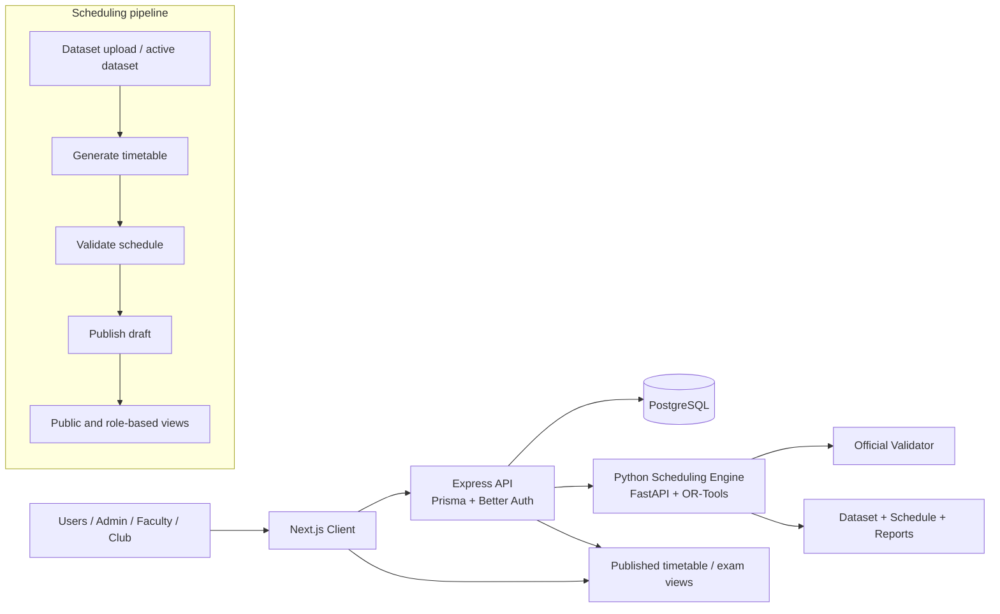

# CIT Smart Scheduler

CIT Smart Scheduler is a full-stack academic operations platform for Chilika Institute of Technology (CIT). It automates timetable generation, exam scheduling, room bookings, disruption recovery, and publication workflows while enforcing institutional rules through an official validator.

The system is built around three main layers:

- a Next.js client for authenticated role-based workflows
- an Express + Prisma API for datasets, jobs, approvals, and public views
- a Python FastAPI scheduling engine that uses CP-SAT optimization and validator-backed checks

## What this project does

The platform supports:

- generating and publishing class timetables
- generating and publishing exam timetables
- handling booking requests for events and lectures
- checking draft bookings against the published timetable
- proposing and validating repair plans after disruptions
- managing datasets, publication/versioning, and audit trail data
- exposing role-aware views for administrators, coordinators, faculty, and club users
- providing an LLM-powered assistant for natural-language queries over the current dataset

## Architecture overview



## Solution architecture

### 1. Presentation layer

Location: `client/`

This is a Next.js 16 application with App Router pages for:

- administrator dashboards and scheduling management
- faculty and department views
- bookings and change requests
- public timetable and exam pages
- login and authorization flow

Main responsibilities:

- render role-aware scheduling dashboards
- submit generation and validation jobs
- display published schedules and reports
- let users request, approve, and track bookings and changes

### 2. API layer

Location: `server/`

The server is an Express application that provides the domain API and orchestration layer.

Core modules include:

- `datasets/` — active dataset handling and upload workflow
- `timetables/` — timetable generation, validation, publishing, and public views
- `exams/` — exam scheduling jobs and published exam views
- `bookings/` — booking request workflows and draft checks
- `changes/` — disruption/change proposals and reviews
- `jobs/` — async background job system
- `settings/` — app configuration and admin settings
- `assistant/` — AI assistant endpoint over the active dataset and user context

Authentication and authorization are handled through Better Auth plus Prisma-backed user and session models.

### 3. Scheduling engine

Location: `Engine/`

The scheduling engine is a separate Python service built with FastAPI. It is stateless and designed to generate, validate, repair, and explain schedules.

It provides endpoints such as:

- `GET /health`
- `POST /validate`
- `POST /timetable/generate`
- `POST /exams/generate`
- `POST /bookings/decide`
- `POST /bookings/check-draft`
- `POST /repair`
- `POST /explain/session`
- `POST /explain/booking`

The solver layer uses Google OR-Tools CP-SAT to optimize timetable and exam assignments while producing soft-penalty scores and violation reports. The official validator stored in `Engine/vendor/validator.py` is treated as the source of truth for hard constraints.

### 4. Data and artifacts

Location: `data/`, `exports/`, `examples/`

- `data/csv/` contains source datasets for sessions, rooms, exams, faculty, and booking requests
- `data/cit_public.json` represents the public dataset model used in validation and generation
- `exports/` stores generated schedules, validation reports, and repair output artifacts
- `examples/` contains sample disruption and request payloads used for testing and demo flows

## Key workflow

The system follows a standard scheduling lifecycle:

1. A dataset is uploaded or activated in the server.
2. The admin triggers timetable or exam generation.
3. The API creates a background job and delegates generation to the Python engine.
4. The engine returns a schedule plus detailed validation metadata.
5. The server checks for hard violations and stores draft results.
6. An admin publishes only those drafts that satisfy validator rules.
7. Public and role-based views read from the published schedule and dataset snapshot.
8. Booking requests and disruption proposals are validated against the current published timetable.

## Technology stack

### Frontend

- Next.js 16
- React 19
- TypeScript
- Tailwind CSS
- TanStack Query
- shadcn-inspired UI components

### Backend

- Node.js 22+
- Express 5
- Prisma ORM
- PostgreSQL
- Better Auth
- Zod validation
- OpenAI integration for the assistant feature

### Scheduling engine

- Python 3.11+
- FastAPI
- Uvicorn
- Pydantic v2
- OR-Tools CP-SAT
- Pytest

## Repository structure

```text
.
├── README.md                           # project overview and setup guide
├── docker-compose.yml                 # PostgreSQL local development database
├── package.json                       # repo-level package metadata
├── validator.py                       # standalone official scheduling validator
├── client/                            # Next.js frontend application
│   ├── app/                           # app routes and screens
│   ├── components/                   # shared components
│   ├── lib/                          # API clients and helpers
│   ├── public/                       # static assets
│   └── package.json
├── server/                            # Express API and domain services
│   ├── src/                          # application source
│   ├── scripts/                      # admin/demo scripts
│   ├── .env.example                  # environment template
│   ├── package.json
│   └── src/prisma/                   # Prisma schema and migrations
├── Engine/                            # Python scheduling engine
│   ├── app/                          # FastAPI app, validation, solver, repair, explain
│   ├── scripts/                      # end-to-end run scripts
│   ├── tests/                        # engine tests
│   ├── vendor/                       # validator source used by the engine
│   ├── requirements.txt
│   ├── Dockerfile
│   └── README.md
├── data/                              # source datasets and sample data
│   ├── csv/
│   └── cit_public.json
├── examples/                          # example disruptions and request payloads
├── exports/                           # generated schedules and reports
├── scheduling-engine/                 # repository area for engine related artifacts or scripts
└── server/README.md                   # API-focused server notes
```

## Getting started

### Prerequisites

- Node.js 22+
- npm or pnpm
- Python 3.11+
- Docker (for PostgreSQL)

### 1. Start PostgreSQL

```bash
docker compose up -d postgres
```

### 2. Configure the server

```bash
cd server
cp .env.example .env
npm install
```

Then update `.env` as needed, especially:

- `DATABASE_URL`
- `BETTER_AUTH_SECRET`
- `CLIENT_ORIGIN`
- `ENGINE_URL`
- `OPENAI_API_KEY` if you want the scheduler assistant enabled

Run the API:

```bash
npm run dev
```

### 3. Start the scheduling engine

```bash
cd Engine
python -m venv .venv
source .venv/bin/activate
pip install -r requirements.txt
uvicorn app.main:app --host 127.0.0.1 --port 8000 --reload
```

### 4. Start the client

```bash
cd client
npm install
npm run dev
```

Open the client at:

- http://localhost:3000

The API is exposed at:

- http://localhost:5000

The engine API is exposed at:

- http://localhost:8000/docs

## Common development tasks

### Run server tests

```bash
cd server
npm test
```

### Run engine tests

```bash
cd Engine
python -m pytest tests -v
```

### Build the client

```bash
cd client
npm run build
```

### Run the engine integration flow

```bash
cd Engine
python scripts/run_all.py
```

This creates exports such as:

- `exports/schedule.json`
- `exports/validation_report.json`
- `exports/schedule_after.json`
- `exports/repair_report.json`

## Role model and user flows

The application is designed for multiple institutional roles:

- Administrator — dataset management, generation, publication, global control
- Coordinator — department or scheduling oversight
- Faculty — own timetable, booking requests, and approvals
- Club / event organizer — booking submission and request tracking

Role-aware access is enforced in server middleware and route-level guards.

## Validation and compliance

A core principle of the project is that the official validator is authoritative.

- hard constraint violations are rejected
- timetable and exam publication depends on validator results
- generated schedules are stored with metadata and reports
- repair plans are evaluated and compared against the baseline schedule

This prevents the app from publishing a schedule that violates the scheduling rules even when optimization logic suggests a feasible-looking result.

## Status

This repository represents an active full-stack scheduling application combining optimization, validation, workflow automation, and role-based user interfaces for academic operations.

## License

This project does not currently declare a repository-wide license in the root package metadata. Use the institutional or hackathon guidance governing your deployment before publishing or distributing the code.
